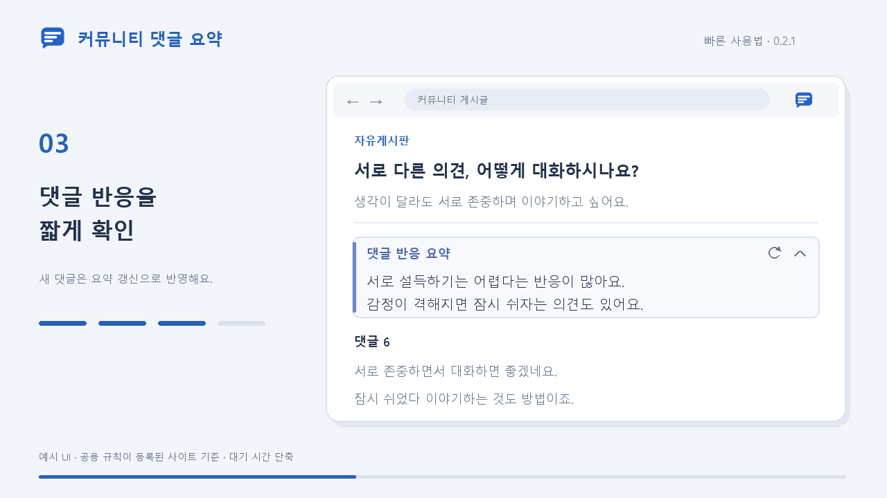

# 커뮤니티 댓글 요약 확장프로그램

커뮤니티에서 현재 로드된 텍스트 댓글을 GPT-6 Luna (`low`)로 짧게 요약하는 크롬 확장기능입니다.
긴 댓글을 전부 읽기 전에, 어떤 반응이 많은지 1~2문장으로 확인할 수 있습니다.
개발자가 API 비용을 부담하고 있어, 사용자가 API 키를 등록할 필요는 없습니다.

## 구성

- 확장프로그램(클라이언트, `apps/extension`): 댓글 추출, 요약 표시, 사이트별 설정을 담당합니다.
- 백엔드(apps/api) : /summarize 엔드포인트를 확장프로그램에 제공합니다.

`/summarize`는 게시글 제목·본문을 맥락으로 참고하고, 전달받은 텍스트 댓글의 반응을 짧게 요약합니다.

## 사용법

### 14초 사용법

[](Demo_/quick-start-v2.mp4)

[사용법 영상 보기 · MP4, 14초](Demo_/quick-start-v2.mp4)

설치가 끝난 상태를 기준으로 합니다. 영상은 공용 규칙이 등록된 사이트에서의 사용 흐름을 보여주는 예시 UI이며, 대기 시간은 단축했습니다.

### 처음 사용하는 사이트

1. 커뮤니티 게시글을 열고 댓글이 보이도록 합니다.
2. 확장 아이콘 → **사이트 권한 허용 및 적용**을 눌러 해당 사이트 접근을 허용합니다.
3. 공용 규칙이 있으면 댓글 추출을 확인한 뒤 바로 적용합니다. 이미 권한을 허용한 사이트는 다음 방문부터 자동으로 확인합니다.
4. 공용 규칙이 없으면 새 규칙 생성과 미리보기가 이어집니다. 댓글 본문이 잘 나오는지 확인한 뒤 **이 내용으로 저장**을 누릅니다.

사이트 구조에 따라 별도 설정이 필요할 수 있습니다. 공통 규칙이 적용되지 않는 게시판은 **이 게시판 맞춤 설정**으로 규칙을 만들어 사용하면 됩니다.
기존에 게시판별로 설정한 사이트는 **사이트 공통 규칙 만들기**로 공통 범위를 설정할 수 있습니다.

### 요약 확인과 설정

- 댓글 목록 위에서 요약을 확인합니다. 제목이나 접기 버튼으로 접었다 펼칠 수 있습니다.
- 새 댓글을 반영하려면 댓글을 로드한 뒤 카드의 **요약 갱신** 버튼을 누릅니다.
- 확장 팝업 → **설정**에서 요약 기능, 기본 펼침 여부, 요약 말투를 변경합니다.

| 말투 | 예시 |
| --- | --- |
| 음슴체 | 신고자를 비판하는 반응이 많음. |
| **해요체 · 기본** | 신고자를 비판하는 반응이 많아요. |
| 습니다체 | 신고자를 비판하는 반응이 많습니다. |

말투를 바꿔도 기존 요약은 유지됩니다. 새 요약이나 **요약 갱신**부터 선택한 말투가 적용됩니다.

### 잘 안 될 때

- 댓글이 늦게 로드되면 1초 간격으로 2회 더 추출을 확인합니다. 재시도 때문에 새 규칙을 자동 생성하지는 않습니다.
- 팝업에서 추출 상태와 **공용 규칙에서 적용 / AI로 새로 생성** 여부를 확인할 수 있습니다.
- 이미지 댓글만 있거나 텍스트 댓글이 없으면 요약을 만들 수 없습니다. 새로고침 없이 게시글이 바뀌는 사이트는 페이지를 새로고침해 주세요.
- 새 규칙 생성은 설치 ID 기준 최근 24시간 **전체 10회·동일 호스트 10회**까지 가능합니다. 공용 규칙 조회·자동 적용은 횟수를 차감하지 않습니다.

더 자세한 동작은 [사이트별 규칙 안내](SITE_RULES.md)를 참고하세요.

### 소스에서 확장 설치

Node.js 22 이상에서 `npm install` → `npm run build`를 실행합니다.
Chrome의 `chrome://extensions`에서 개발자 모드를 켜고 **압축해제된 확장 프로그램을 로드** → `apps/extension/dist`를 선택합니다.
코드를 업데이트했다면 확장 관리 화면에서 새로고침한 뒤 게시글도 새로고침합니다.

## 백엔드 직접 구축하기

백엔드까지 직접 구현하고 싶은 경우 아래 사용법 참고.

### 배포방법 (백엔드)

- Production 환경변수 `OPENAI_API_KEY`를 입력해주어야합니다.
- 공용 규칙 저장과 생성 횟수 제한에는 Upstash Redis 환경변수도 필요합니다. 자세한 설정은 [배포 안내](DEPLOYMENT.md)를 참고하세요.
- `api/index.ts`가 Fastify 앱을 연결합니다. 공통 contracts는 배포 빌드에서 JavaScript로 컴파일합니다.
- `/health`는 키 없이 서버 동작을 확인합니다.

### 백엔드 실행

프로젝트 폴더에서 다음 명령을 실행합니다.

```powershell
npm install
npm run build
npm run dev:api
```

로컬 서버를 확장에 연결하려면 빌드 전에 `$env:VITE_SUMMARY_API_URL='http://127.0.0.1:4318'`을 설정합니다.
기본 빌드는 Vercel 서버를 사용하므로 로컬 서버를 실행할 필요가 없습니다.
`apps/api/.env`에 `OPENAI_API_KEY=발급받은키`를 입력하고 API 서버를 다시 시작합니다.
키는 Git과 확장 번들에 포함되지 않습니다.

## 동작

- 기본값은 기능 사용 및 펼침입니다. 카드가 화면 200px 이내로 접근하면 자동 요청합니다.
- 접기는 현재 페이지에만 적용합니다. 기본 펼침 설정은 새 게시글/새로고침부터 적용합니다.
- 기능 사용 설정은 열려 있는 페이지에도 반영됩니다. 이미 시작한 요청은 완료될 수 있습니다.
- 추가 댓글을 읽으려면 사이트에서 댓글을 로드한 뒤 **요약 갱신**을 누릅니다.
- 요약 결과는 확장의 `chrome.storage.local`에 게시판·게시글별로 저장합니다. 새로고침·재방문 시 저장된 결과를 표시하며 자동 재요청하지 않습니다.
- **요약 갱신**은 기존 결과 캐시를 건너뛰어 요청하고 성공한 결과로 저장 내용을 교체합니다. 확장을 삭제하면 로컬 요약·설정도 삭제됩니다.
- 최대 300개 텍스트 댓글, 댓글당 2,000자, 총 댓글 60,000자까지 전달합니다.
- 이미지 댓글은 제외하고 본문 이미지는 해석하지 않습니다. 제한 적용 여부를 카드에 표시합니다.
- 답글 여부만 전달합니다. 정확한 부모 댓글 ID는 HTML에서 보장되지 않아 추측하지 않습니다.
- 같은 입력·말투는 서버에서 10분간 캐시하고 동시 요청은 합칩니다. 이 캐시는 서버 인스턴스 내에서만 공유합니다.

## 개발 확인

```powershell
npm run typecheck
npm test
npm run build
```
